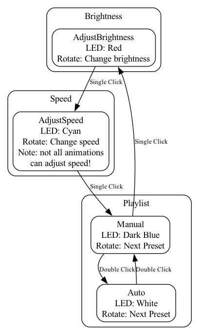

# Uzumaru 渦丸


Uzumaru ("whirlpool circle") is a round LED lamp: 256 LEDs on a Fibonacci spiral behind a seamless paper diffuser, with one
RGB rotary knob to control it. It runs on an ESP32 and shows a playlist of 30 animated patterns, seven of them written
specifically for the spiral's geometry.

It builds on other people's work, see [CREDITS.md](CREDITS.md): the [Splendida 256](https://github.com/wokwi/splendida) PCB
by Uri Shaked (Wokwi) and the patterns and lookup tables of
[ldirko's Splendida firmware](https://github.com/ldirko/New-Colorful-Splendida-256-firmware-).

## Hardware

- **LEDs**: a Splendida 256 PCB (256 WS2812B on a Fermat spiral), data on GPIO 22.
- **Controller**: M5Stack Atom Matrix (ESP32-PICO-D4).
- **Knob**: [DuPPa I2C Encoder V2](https://www.duppa.net/) with an RGB rotary encoder; SDA 33, SCL 23, INT 19, address 0x28.
- **Enclosure**: the seamless paper diffuser in [extras/Seamless Paper Diffusor](extras/Seamless%20Paper%20Diffusor). More
  diffuser options are in [extras](extras/README.md).
- **Music (planned)**: a [beatsense](https://github.com/costyn/beatsense) board on the same I2C bus (address 0x42).

Pins and tuning constants are in [`src/config.h`](src/config.h).

## Controls

One knob. Its LED shows the mode; when you leave it alone it mirrors the lamp's colour.

| Action                       | Result                                                        |
| ---------------------------- | ------------------------------------------------------------- |
| Click                        | Next mode: brightness (red) → speed (cyan) → playlist (yellow) |
| Turn, brightness mode        | Brighter / dimmer (finer steps when dim)                      |
| Turn, speed mode             | Faster / slower; past zero the patterns run backwards         |
| Turn, playlist mode          | Next / previous pattern                                       |
| Double click, playlist mode  | Automatic pattern changes on (white) / off (blue)             |

Patterns crossfade over about 4 seconds and change automatically every ~2 minutes; the palette changes every 19 seconds.


## Patterns

**New for Uzumaru** ([`src/patterns/spiral.cpp`](src/patterns/spiral.cpp)). These use [`src/geometry.h`](src/geometry.h),
which gives every LED its exact position, angle, radius and seed rank on the spiral, so they can address the board's visible
spiral arms directly (21 winding clockwise, 34 counter-clockwise):

| Pattern     | What it does                                                                                  |
| ----------- | --------------------------------------------------------------------------------------------- |
| Uzumaki     | A two-armed spiral that turns and draws you towards the centre                                 |
| Parastichy  | Light runs round the 21 clockwise and the 34 counter-clockwise arms in turn                    |
| Bloom       | A sunflower grows seed by seed, flowers, then sheds its seeds                                  |
| SeedRunners | Comets race outward along one family of arms and inward along the other                        |
| Ripples     | Drops on a pond, with rings at true distances (on the beat with beatsense)                     |
| Vortex      | Sparks orbit and spiral down the drain                                                         |
| Heartbeat   | A ring of light per beat; follows the music with beatsense, otherwise a resting pulse          |

**From the Splendida firmware** ([`src/patterns/ldirko.cpp`](src/patterns/ldirko.cpp)): ldirko's planar and cylindrical
patterns and Mark Kriegsman's pride and colorwaves, adapted for crossfading and the speed knob. My own patterns on ldirko's
lookup maps are in [`src/patterns/mapped.cpp`](src/patterns/mapped.cpp). The playlist order is in
[`src/patterns/playlist.cpp`](src/patterns/playlist.cpp).

## Building

```
pio run -e m5stack_atommatrix              # build
pio run -e m5stack_atommatrix -t upload    # flash
pio device monitor                         # serial log: pattern and palette changes
```

Dependencies track the latest releases (see [`platformio.ini`](platformio.ini)); CI builds weekly to catch upstream breakage. Every push is built by GitHub Actions.

## Previewing patterns without the lamp

[`tools/preview`](tools/preview/README.md) compiles the pattern code for your computer with the real FastLED and renders it
onto the true LED positions, as PNG stills or an HTML page with every pattern animated.

```
pio run -e m5stack_atommatrix              # once, downloads FastLED
tools/preview/build.sh
python3 tools/preview/make_preview.py html preview.html
```

The firmware also runs in [Wokwi](https://wokwi.com) (`wokwi.toml`, `diagram.json`), without the knob.

## Source layout

```
src/main.cpp            tasks, render loop, crossfade between two pattern buffers, brightness, palettes
src/config.h            pins and tuning constants
src/encoder.cpp         the knob
src/audio.cpp           music hook: beatsense frame, or a synthetic beat
src/palettes.cpp        palette playlist (cpt-city / WLED palettes)
src/tables.h            ldirko's planar (20x20) and cylindrical (45x11) lookup tables
src/geometry.h          exact per-LED geometry (generated by tools/gen_geometry.py)
src/patterns/           the patterns, see above
tools/                  geometry generator and desktop preview renderer
extras/                 diffusers, stands, PCB drawings, layout images
```

## License

The firmware is GPL-3.0 ([LICENSE](LICENSE)), as is ldirko's firmware it is based on. The Splendida PCB design is CC BY-SA 4.0
by Uri Shaked. See [CREDITS.md](CREDITS.md) for every third-party part and its license.

## Hardware roadmap

- APA102 / APA107 / HD107s / HD108 LEDs
- DuraClik connectors
- SN74AHCT125N level shifter on a breakout
- M5Stack Stamp instead of the Atom Matrix
