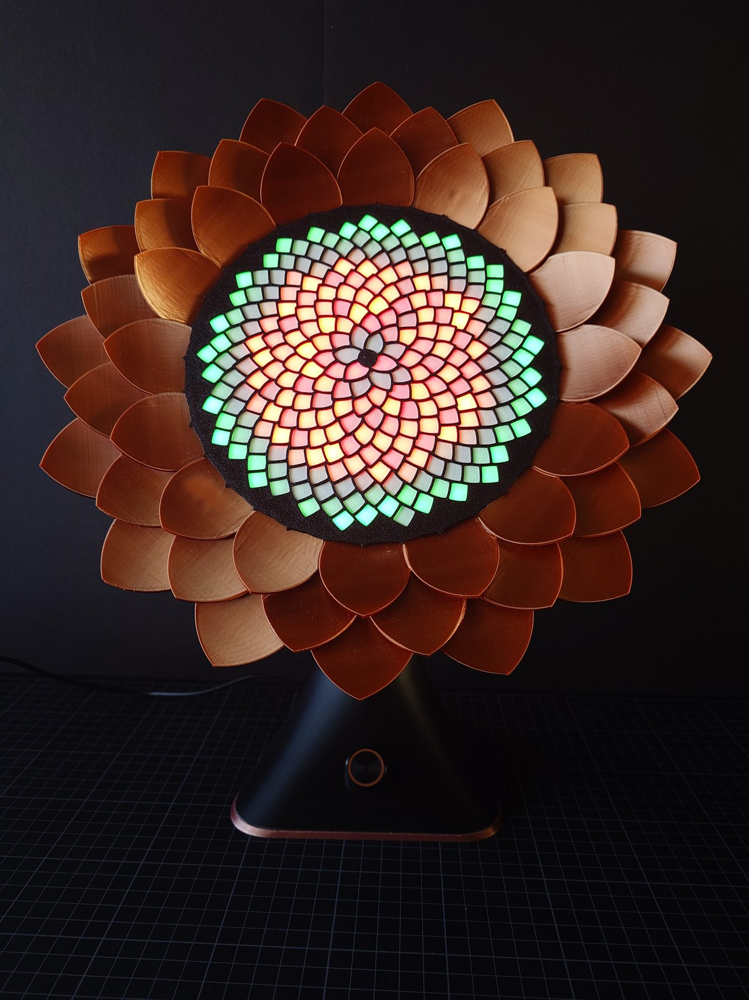
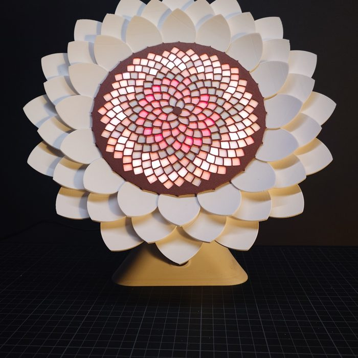
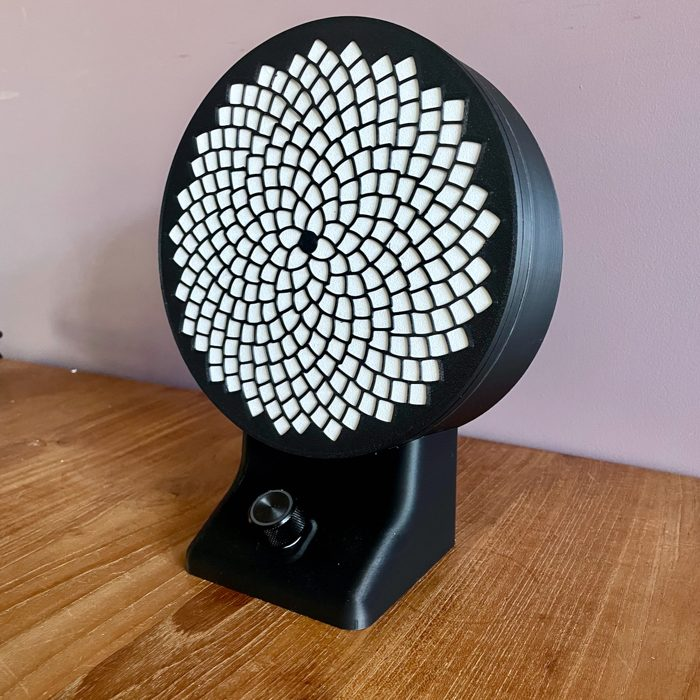
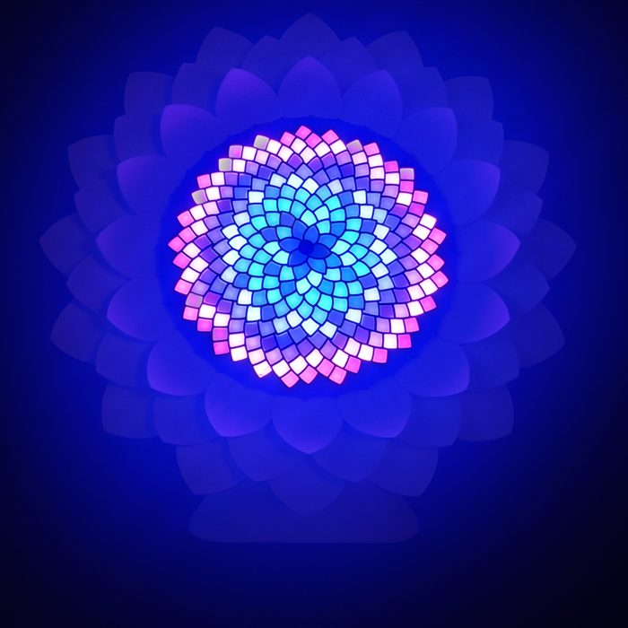
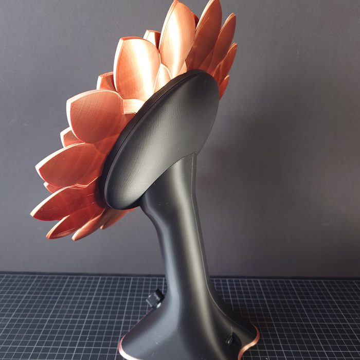

# Uzumaru 渦丸

<p align="center"></p>

Uzumaru combines the Japanese words "uzumaki" (spiral) and "maru" (circle) into a light sculpture: 256 LEDs arranged on a
Fibonacci spiral like the seeds of a sunflower, in a 3D-printed flower, with a single colour-lit knob to control it. It runs
on an ESP32 and plays 39 animated patterns, eight of them written specifically for the spiral's geometry.

| | | | |
|---|---|---|---|
|  |  |  |  |

- **[Watch every pattern in your browser](https://costyn.github.io/uzumaru/preview/)**, rendered by this firmware's own code
  on the real LED positions.
- **[Photo gallery](https://costyn.github.io/uzumaru/)** of the black/copper, white/brown and desktop models.
- **[User manual (PDF)](extras/Manual.pdf)**.

It builds on other people's work, see [CREDITS.md](CREDITS.md): the [Splendida 256](https://github.com/wokwi/splendida) PCB
by Uri Shaked (Wokwi) and the patterns and lookup tables of
[ldirko's Splendida firmware](https://github.com/ldirko/New-Colorful-Splendida-256-firmware-).

## Hardware

- **LEDs**: a Splendida 256 PCB (256 WS2812B on a Fermat spiral).
- **Controller**: M5Stack Atom S3 Lite (ESP32-S3), powered over USB-C. The first lamps used an M5Stack Atom Lite
  (ESP32-PICO-D4), which is still supported.
- **Knob**: [DuPPa I2C Encoder V2](https://www.duppa.net/) with an RGB rotary encoder, I2C address 0x28.
- **Enclosure**: 3D printed, in black or white, as a tall flower or a compact desktop model. Earlier diffuser designs
  (paper, PLA, ldirko's shell) are in [extras](extras/README.md).
- **Music (planned)**: a [beatsense](https://github.com/costyn/beatsense) board on the same I2C bus (address 0x42).

| Board                     | Environment           | LED data | I2C SDA / SCL / INT | LED power budget |
| ------------------------- | --------------------- | -------- | ------------------- | ---------------- |
| Atom S3 Lite (default)    | `m5stack_atomlite_s3` | GPIO 8   | 5 / 6 / 7           | 1500 mA          |
| Atom Lite                 | `m5stack_atomlite`    | GPIO 22  | 33 / 23 / 19        | 800 mA           |

Board pins are in [`src/boards/`](src/boards), tuning constants in [`src/config.h`](src/config.h).

## Controls

One knob. Its LED shows the mode; when you leave it alone it mirrors the lamp's colour.

| Action                       | Result                                                        |
| ---------------------------- | ------------------------------------------------------------- |
| Click                        | Next mode: brightness (red) → speed (cyan) → playlist (yellow) |
| Turn, brightness mode        | Brighter / dimmer (finer steps when dim)                      |
| Turn, speed mode             | Faster / slower; past zero the patterns run backwards         |
| Turn, playlist mode          | Next / previous pattern                                       |
| Double click, playlist mode  | Automatic pattern changes on (white) / off (blue)             |

Patterns crossfade over about 4 seconds and change automatically every ~2 minutes; the palette changes every 19 seconds.


## Patterns

**New for Uzumaru** ([`src/patterns/spiral.cpp`](src/patterns/spiral.cpp)). These use [`src/geometry.h`](src/geometry.h),
which gives every LED its exact position, angle, radius and seed rank on the spiral, so they can address the board's visible
spiral arms directly (21 winding clockwise, 34 counter-clockwise):

| Pattern     | What it does                                                                                  |
| ----------- | --------------------------------------------------------------------------------------------- |
| Uzumaki     | A two-armed spiral that turns and draws you towards the centre                                 |
| Parastichy  | Light runs round the 21 clockwise and the 34 counter-clockwise arms in turn                    |
| Bloom       | A sunflower grows seed by seed, flowers, then its seeds pop out one by one                     |
| SeedRunners | Comets race outward along one family of arms and inward along the other                        |
| Ripples     | Drops on a pond, with rings at true distances (on the beat with beatsense)                     |
| Vortex      | Sparks orbit and spiral down the drain                                                         |
| Heartbeat   | A ring of light per beat; follows the music with beatsense, otherwise a resting pulse          |
| ColorWheel  | The palette round the disc, squeezed and stretched as it swirls (replaces testCylinderMapping2) |

**From Jason Coon's [Fibonacci256](https://www.evilgeniuslabs.org/fibonacci256)** ([`src/patterns/fibonacci256.cpp`](src/patterns/fibonacci256.cpp)),
made for the same board layout: Emitter, SwirlFibonacci, Pacifica and PolarNoise.

**From [WLED](https://github.com/wled/WLED)'s 2D effects** ([`src/patterns/wled.cpp`](src/patterns/wled.cpp)), rewritten for
the disc: Octopus, PolarLights, SunRadiation and DriftRose.

**From the Splendida firmware** ([`src/patterns/ldirko.cpp`](src/patterns/ldirko.cpp)): ldirko's planar and cylindrical
patterns and Mark Kriegsman's pride and colorwaves, adapted for crossfading and the speed knob. My own patterns on ldirko's
lookup maps are in [`src/patterns/mapped.cpp`](src/patterns/mapped.cpp). The playlist order is in
[`src/patterns/playlist.cpp`](src/patterns/playlist.cpp).

## Building

```
pio run                                     # build for the Atom S3 Lite (default)
pio run -t upload                           # flash it
pio run -e m5stack_atomlite -t upload       # the older Atom Lite
pio device monitor                         # serial log: pattern and palette changes
```

Dependencies track the latest releases (see [`platformio.ini`](platformio.ini)); CI builds weekly to catch upstream breakage. Every push is built by GitHub Actions.

## Previewing patterns without the lamp

[`tools/preview`](tools/preview/README.md) compiles the pattern code for your computer with the real FastLED and renders it
onto the true LED positions, as PNG stills or an HTML page with every pattern animated.

```
pio run                                     # once, downloads FastLED
tools/preview/build.sh
python3 tools/preview/make_preview.py html preview.html
```

The published version is at <https://costyn.github.io/uzumaru/preview/>; `tools/preview/publish.sh` refreshes it.

The firmware also runs in [Wokwi](https://wokwi.com) (Atom Lite build, without the knob); see
[tools/wokwi](tools/wokwi/README.md).

## Source layout

```
src/main.cpp            tasks, render loop, crossfade between two pattern buffers, brightness, palettes
src/config.h            tuning constants; src/boards/*.h: pins per controller board
src/encoder.cpp         the knob
src/audio.cpp           music hook: beatsense frame, or a synthetic beat
src/palettes.cpp        palette playlist (cpt-city / WLED palettes)
src/tables.h            ldirko's planar (20x20) and cylindrical (45x11) lookup tables
src/geometry.h          exact per-LED geometry (generated by tools/gen_geometry.py)
src/patterns/           the patterns, see above
tools/                  geometry generator and desktop preview renderer
extras/                 manual, diffusers, stands, PCB drawings, layout images
attic/                  old sketches, kept for reference
```

## License

The firmware is GPL-3.0 ([LICENSE](LICENSE)), as is ldirko's firmware it is based on. The Splendida PCB design is CC BY-SA 4.0
by Uri Shaked. See [CREDITS.md](CREDITS.md) for every third-party part and its license.

## Hardware roadmap

- APA102 / APA107 / HD107s / HD108 LEDs
- DuraClik connectors
- SN74AHCT125N level shifter on a breakout
- M5Stack Stamp instead of the Atom
